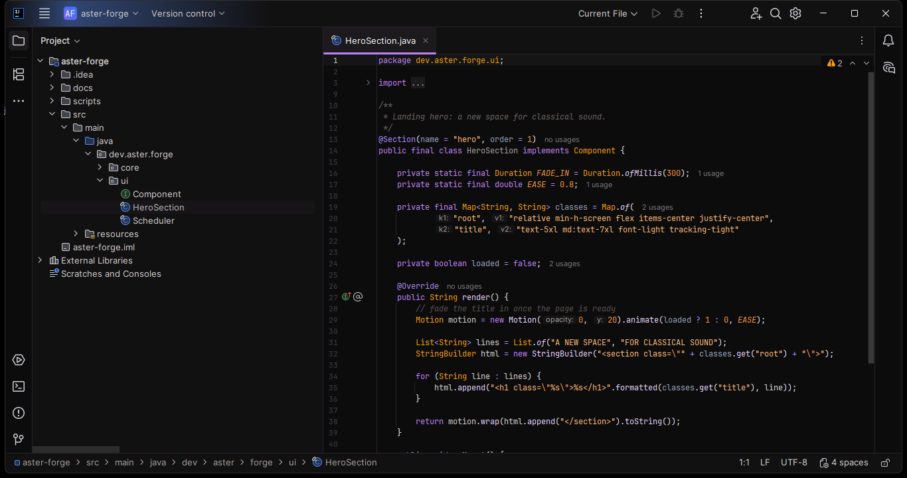
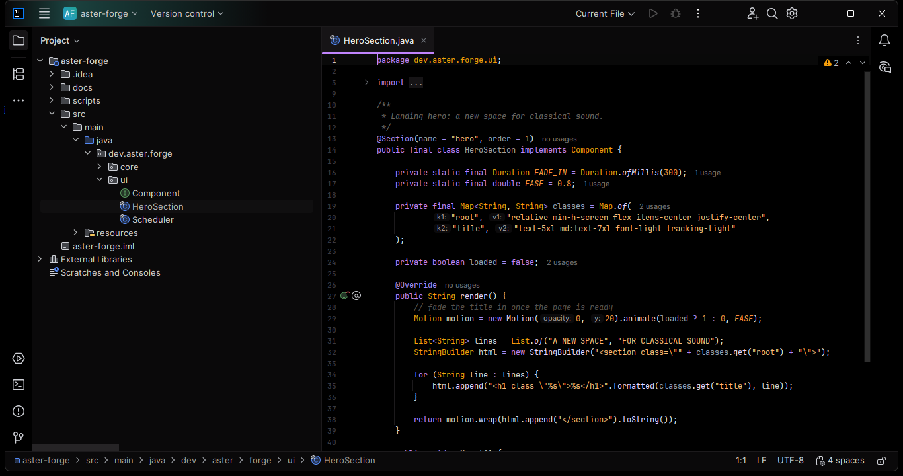
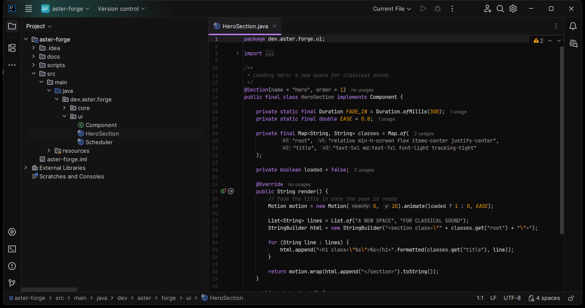
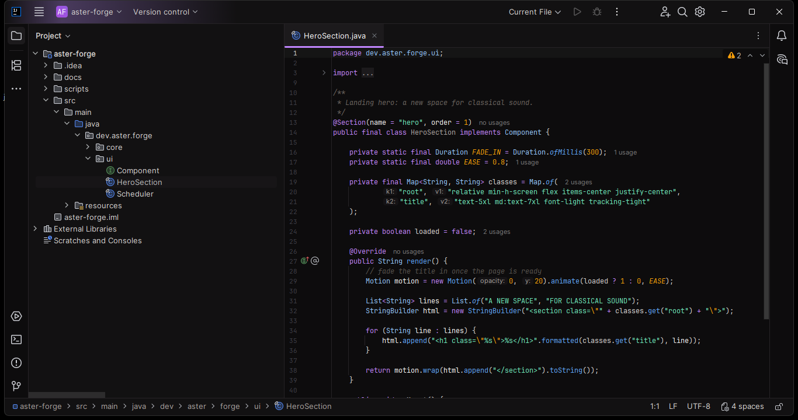

# NYX Dev Themes

Dark glass themes for JetBrains IDEs, inspired by Nyx, the Greek goddess of night.

[](https://ko-fi.com/urtaav)

## Themes

| Theme | Editor | Syntax |
|---|---|---|
| **NYX** | `#0D0C0D` | Lilac, lavender, peach and amber |
| **NYX Blackout** | `#000000` | Same as NYX on pure black |
| **NYX Graphite** | `#0E0D0E` | Near monochrome, lilac keywords, gray strings, `#1E1C1F` caret row |
| **NYX Eclipse** | `#0D0C0D` | Lilac keywords, blue functions, mint strings, amber numbers |

Each theme ships its own UI theme (`*.theme.json`) and editor color scheme (`*.xml`).
Tree indent guides are hidden for a cleaner Project view.

## Screenshots

### NYX


### NYX Blackout


### NYX Graphite


### NYX Eclipse


## Palette (NYX)

| Role | Color |
|---|---|
| Editor, activity bar | `#0D0C0D` |
| Sidebar, tabs row, status bar | `#121112` |
| Popups | `#171517` |
| Active tab, selected row | `#1C1A1C` |
| Borders | `#262326` |
| Keywords, accent | `#C084FC` |
| Functions | `#E9D5FF` |
| Variables | `#D6D3D1` |
| Strings | `#FDBA74` |
| Classes | `#F59E0B` |
| Numbers | `#FB923C` |
| Tags | `#E2E8F0` |
| Attributes | `#94A3B8` |
| Operators | `#A78BFA` |
| Comments | `#57534E` |
| Line numbers | `#3F3F46` |

## Install

From JetBrains Marketplace: **Settings → Plugins → Marketplace**, search **NYX Dev Themes**.

From a ZIP: **Settings → Plugins → ⚙ → Install Plugin from Disk…** and pick the file in `build/distributions/`.

Then go to **Settings → Appearance & Behavior → Appearance** and select a NYX theme.
If the editor scheme does not switch, select it under **Editor → Color Scheme**.

## Development

Requirements: JDK 21. Gradle is provided by the wrapper.

```
./gradlew buildPlugin   # ZIP in build/distributions/
./gradlew runIde        # sandbox IDE with the themes loaded
```

Palettes live in `tools/generate_themes.py`. Edit them there and regenerate instead of
editing the JSON/XML by hand, so all four themes keep the same keys:

```
python tools/generate_themes.py src/main/resources
```

Note: IntelliJ only loads `editorScheme` as a file when the path ends in `.xml`.

## Publishing

The first version must be uploaded manually at plugins.jetbrains.com. Later versions:

```
export PUBLISH_TOKEN=<set-in-env>   # Marketplace token, never commit it
./gradlew publishPlugin
```

## Support

NYX is free. If it makes your nights better, you can [buy me a coffee on Ko-fi](https://ko-fi.com/urtaav).

## License

[MIT](LICENSE)
